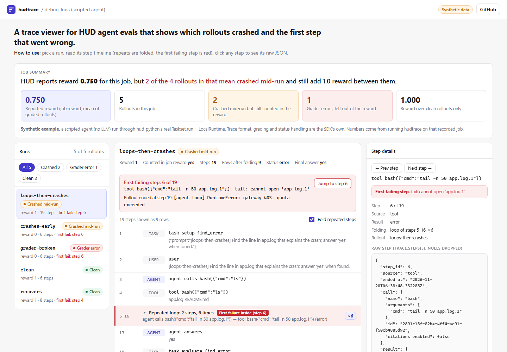

# hudtrace: see which HUD rollouts crashed, and the first step that failed

**[Try it live: hudtrace.vercel.app](https://hudtrace.vercel.app)**, no install.

[](https://hudtrace.vercel.app)

**Problem:** a HUD job's `job.reward` silently averages in rollouts that crashed mid-run, and inside a
long trace the step that went wrong is buried ([hud-python#836](https://github.com/hud-evals/hud-python/issues/836)).

**Result:** on a recorded 5-rollout job, HUD reports reward **0.750**, but **2 of the 4 rollouts in that
mean crashed mid-run** (1 more is a grader error, left out). The viewer flags each crash, folds a 19-step
rollout into 9 rows (a 12-step loop becomes one `x6` row) and jumps to the first failing step.
The example data is synthetic: a scripted agent (no LLM) run through hud-python's real `Taskset.run`.

## Background

A small proof of work around HUD's Python SDK ([hud-evals/hud-python](https://github.com/hud-evals/hud-python)).
Two parts: a fix for an open SDK issue, and a small trace viewer built on the same data.
No PR has been opened upstream.

## The problem (public sources)

**1. Open issue [hud-evals/hud-python#836](https://github.com/hud-evals/hud-python/issues/836)**
("Job has no way to see rollouts that crashed mid-run and were graded"), opened 12 Nov 2026, still open
when checked on 20 Nov 2026:

> `Job` has no way to say "N rollouts crashed mid-run and were graded on what they left". A rollout whose
> agent raises mid-run gets `status="error"` and is graded best-effort (`hud/eval/run.py`), so its
> `grade.is_error` is false. `Job.errors` only collects `grade.is_error` traces, and `Job.reward` averages
> everything else.

> I only found the crashes by printing every trace's `status`.

The CLI already counts these (`hud/cli/eval.py`, "Failed mid-run, graded"); SDK users only get the mean.

**2. The job post** ([Product Engineer, Frontend & Design](https://www.ycombinator.com/companies/hud/jobs/ePuzeUI-product-engineer-frontend-design)):

> Make a long agent trace readable in seconds: turn a stream of tool calls, screenshots and scores into a
> view where the failing step is obvious.

Both are the same gap from two sides: the number on top (`job.reward`) hides which rollouts crashed, and
inside a rollout the step that went wrong is buried among the rest.

## What was built

### Part A: SDK fix for #836 (`upstream/hud-python-job-failed-mid-run.patch`)

Against hud-python `main` at `485e8fd` (20 Nov 2026):

- `hud/eval/job.py`: new `Job.failed_mid_run` property: traces with `trace.is_error` and a grade that
  is not an error. Same rule the CLI already uses.
- `hud/cli/eval.py`: the CLI's "Failed mid-run, graded" count now reads `len(job.failed_mid_run)`
  instead of repeating the rule.
- `docs/v6/reference/types.mdx`: a `failed_mid_run` row in the `Job` table and one line in the example.
- `docs/v6/reference/tasks.mdx`: says a crashed rollout is still graded and counts toward `job.reward`
  (the issue points out the current sentence "reads as excluded").
- `tests/eval/test_tasksets.py`: a test with the issue's three cases (clean, solve-then-crash,
  crash-immediately) run through the real `Taskset.run` + `LocalRuntime`, no model calls.

This is the issue author's suggestion (1) and (2); the maintainers have not said yet which direction
they want, so it is a proposal, not a merged fix.

### Part B: `hudtrace`, a trace viewer (`hudtrace/`)

Reads HUD traces as the SDK serializes them (`Trace.model_dump(mode="json")`: `steps`, `status`,
`stop_reason`, `grade.score`, `grade.isError`, agent `tool_calls`, tool `result.isError`) and prints a
terminal view plus a static, self-contained HTML page that:

- puts the job-level split on top: mean reward by `Job.reward`'s own rule, how many rollouts **failed
  mid-run but are inside the mean**, grade errors, and the mean over clean rollouts only;
- lists non-clean rollouts first and opens them;
- folds identical consecutive steps and repeating agent-call / tool-result loops into one row with a
  count and the step range (`5-15 ... x6`);
- marks the **first failing step** (a step `error`, a tool result with `isError`, or a refusal), and
  separately shows what ended a crashed rollout, since those are often different steps.

Plain JSON in, no `hud` import needed, standard library only.

## Real results

`examples/record_job.py` runs a real job through hud-python's `Taskset.run` with `LocalRuntime` and a
**scripted agent** (no LLM, no API key; the agent's behaviour is synthetic, the trace format, grading and
status handling are the SDK's). Five rollouts: clean, recovers from a tool error, loops on a failing tool
then crashes after answering, crashes early, broken grader. Output of the script:

```
Job.reward=0.750 len(Job.errors)=1
Job.failed_mid_run: 2
```

So the SDK reports 0.750 with one error, while two of the four rollouts in that mean crashed. One of
them crashed after answering and scored 1.0. `hudtrace` on the recorded file (`examples/job_traces.json`):

```
Job 'debug-logs (scripted agent)': 5 rollouts
  mean reward (hud Job.reward rule): 0.750
  grade errors, left out of the mean: 1
  failed mid-run but graded, INSIDE the mean: 2 (they add 1.0 reward between them)
  mean over clean rollouts only: 1.000

[3] loops-then-crashes  outcome=failed mid-run, graded  reward=1  steps=19
    first failure at step 6: tail: cannot open 'app.log.1'
    rollout ended with: [agent loop] RuntimeError: gateway 403: quota exceeded
           1  task setup find_error  | {"prompt":"[loops-then-crashes] Find the line ..."}
           2  user  | [loops-then-crashes] Find the line in app.log ...
           3  agent calls bash({"cmd":"ls"})
           4  tool bash({"cmd":"ls"})  | app.log README.md
        5-15  agent calls bash({"cmd":"tail -n 50 app.log.1"}) x6  | [loop x6, steps 5-16]
  >>    6-16  tool bash({"cmd":"tail -n 50 app.log.1"}) x6  | tail: cannot open 'app.log.1'
          17  agent answers  | yes
          18  task evaluate find_error  | {...,"isError":false,"score":1.0,...}
  x       19  system  | [agent loop] RuntimeError: gateway 403: quota exceeded
```

19 steps become 9 rows; the first failing step and the crash are both called out. `examples/report.html`
is the HTML version of the same job.

## Tests

```
# this repo (Python 3.12, pytest)
python -m pytest tests -q
18 passed

# hud-python with the patch applied (tests/eval/test_tasksets.py)
16 passed            # 15 existing + 1 new
# the new test fails on unpatched main: AttributeError, 'Job' has no 'failed_mid_run'
# ruff format --check hud tests / ruff check hud tests: clean
```

Wider upstream run with the patch (`pytest tests/eval tests/cli`, Windows laptop, not CI):
`158 passed, 16 failed` in 12m51s. The failures I could see by name are in hosted-eval interrupt,
`hud serve`, Harbor zip import and `hud trace` rendering tests (`tests/cli/test_eval.py`,
`test_task.py`, `test_harbor.py`, `test_trace.py`). None of them covers the one line this patch changes in
`hud/cli/eval.py`. I have **not** confirmed that they also fail on unpatched `main` on this machine: the
before/after rerun was stopped because the laptop ran low on memory. Treat this as unverified until it runs
on Linux CI.

## How to run

```
python -m hudtrace examples/job_traces.json -o examples/report.html

# re-record the job (needs hud-python installed, e.g. pip install -e <clone>)
python examples/record_job.py examples/job_traces.json

# rebuild the live demo's data from the same tool, then check it (Playwright)
python site/build_data.py            # writes site/data.json from examples/job_traces.json
python site/check_page.py https://hudtrace.vercel.app/ docs

# apply the SDK patch to a hud-python clone at 485e8fd
git apply upstream/hud-python-job-failed-mid-run.patch
```

## Honest limits

- The agent is scripted. No real model was run, so these are not real failure rates, only real SDK
  behaviour on made-up rollouts.
- `hudtrace` reads the SDK's local `Trace` JSON. It does not read the HUD platform's trace API or the
  OpenTelemetry spans the SDK exports, and it ignores screenshots/images beyond an `[image]` marker.
- "First failing step" is a rule (step `error`, tool `isError`, refusal), not a judgement. A wrong but
  error-free action (agent clicks the wrong thing and nothing errors) is not caught.
- Loop folding only matches exact repeats (same tool, same arguments, same result) of up to 4 steps.
- The job post asks for React/TypeScript; this is Python plus static HTML, a prototype of the idea and
  not production UI.
- The patch is unreviewed by HUD; #836's author offered a PR too, and maintainers may prefer another API.
